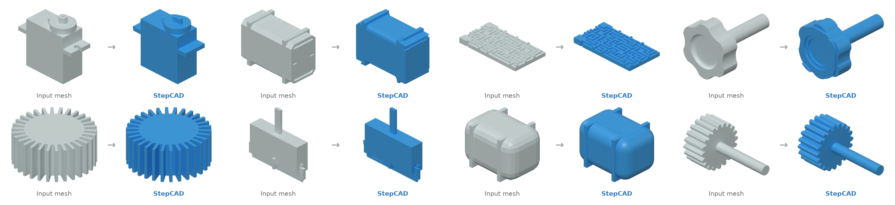

<div align="center">

## StepCAD: Mesh-to-CAD Code Generation via LLM Policy and Geometry-Guided Search

> Ghadi Nehme<sup>1</sup>, Faez Ahmed<sup>1</sup> <br>
> <sup>1</sup>Massachusetts Institute of Technology

[](https://arxiv.org/pdf/2610.03799) [](https://ghadinehme.com/stepcad.github.io/) [](https://www.youtube.com/watch?v=AdfTSnQpQqs) [](https://huggingface.co/DeCoDELab/StepCAD) [](https://huggingface.co/datasets/DeCoDELab/ARCADE)

</div>

<div align="center">
  
</div>

---

## Introduction

**StepCAD** recovers executable, editable CAD programs (CadQuery) from 3D meshes. Existing learning-based methods treat
mesh-to-CAD reconstruction as one-shot sequence prediction, are largely limited to sketch-and-extrude pipelines, and have
no mechanism for refining what they generate. StepCAD instead combines two complementary parts:

1. **Π-StepCAD, a state-conditioned CAD policy.** A Qwen2.5-Coder-1.5B policy writes the program *one operation at a time*.
   At each step it is conditioned on both the target geometry and the intermediate geometry built so far (both encoded
   with a shared Point-MAE). The kernel executes every operation, so each decision sees its own progress.
2. **Geometry-aware program search.** A beam search (K = 2) walks the program in execution order and tries four local
   edits at every operation. It keeps the candidates with the highest IoU against the input mesh, fixing what is
   off while preserving the structure the policy found.

To train the policy, we introduce **ARCADE**, a dataset of 3.5M executable CAD programs with diverse operations and
long construction sequences.

---

## Video

<div align="center">
  <a href="https://www.youtube.com/watch?v=AdfTSnQpQqs">
    
  </a>
</div>

---

## Key Features

- **Step-by-step, state-conditioned generation.** The policy predicts π<sub>θ</sub>(a<sub>t</sub> | Q<sub>t−1</sub>, Q<sub>m</sub>, a<sub>&lt;t</sub>) from the target point cloud, the current shape and the operations written so far.
- **Program-space optimization.** Four local edits per operation: **refine parameters** (Bayesian optimisation of depths, radii and sketch dimensions), **edit sketch** (replace a sketch with the profile sliced from the mesh), **complement cut** (remove overshoot) and **skip operation** (drop a harmful one). Cost is linear in program length.
- **Rich operator set.** Extrude, revolve, loft, sweep, Boolean union and cut, shell, mirror, fillet, chamfer and patterns, far beyond sketch-and-extrude.
- **State of the art on CADBench.** Best median IoU on all seven splits. The gap grows as shapes get more complex.

---

## Results on CADBench

Median IoU (↑) on CADBench (18,000 meshes), scored with the official CADBench code. Baselines use their public checkpoints.
**StepCAD-3.5M** is StepCAD trained on the 3.5M-program ARCADE release, a larger version of the paper's ARCADE-1.5M;
these are the released weights.

| Method | DeepCAD | Fusion 360 | ABC Easy | ABC Medium | ABC Hard | Mechanical | Organic |
|---|:---:|:---:|:---:|:---:|:---:|:---:|:---:|
| CAD-Recode | 0.92 | 0.79 | 0.88 | 0.46 | 0.47 | 0.77 | 0.41 |
| Cadrille | 0.92 | 0.79 | 0.88 | 0.50 | 0.49 | 0.78 | 0.43 |
| CADEvolve | 0.93 | 0.80 | 0.90 | 0.54 | 0.55 | 0.79 | 0.44 |
| CADReasoner | 0.97 | 0.90 | 0.95 | 0.68 | 0.58 | 0.84 | 0.42 |
| **StepCAD-3.5M** | **0.98** | **0.94** | **0.97** | **0.77** | **0.80** | **0.93** | **0.68** |

See the [paper](https://arxiv.org/pdf/2610.03799) for Chamfer distance, valid shape rate and ablations.

---

## ARCADE

**ARCADE** (Artificial Repository of CAD Examples) is on Hugging Face:
[DeCoDELab/ARCADE](https://huggingface.co/datasets/DeCoDELab/ARCADE).

This release is a larger version of the paper's ARCADE-1.5M. **ARCADE** contains **3.54M unique executable CadQuery programs** (3.53M train, 16K validation) with **34.8M
intermediate states**, generated by workflow-inspired strategies:

- Long construction sequences: 108 operations per program on average (median 68, up to 6K).
- Broad coverage of extrude, revolve, sweep, loft, fillet, chamfer, shell and mirror. Prior datasets are mostly sketch-and-extrude.
- Every program is in a canonical step-by-step CadQuery format, re-executes to a valid single solid, and comes with a
  STEP B-rep, a mesh, a 10K-point cloud with normals, and the same after every operation.

| | ARCADE |
|---|---|
| programs | 3,543,874 |
| operations per program, mean (median) | 108.3 (68) |
| solid operations per program | 10.5 (9) |
| B-rep faces | 91.3 (63) |
| intermediate states | 34.8M |
| coverage: extrude / revolve / sweep / loft (%) | 94.7 / 28.3 / 18.6 / 13.8 |
| coverage: fillet / chamfer / shell / mirror (%) | 34.2 / 25.6 / 5.5 / 21.1 |

An operation is a modelling action (workplane, sketch primitive, solid operation or Boolean), faces are read back from
the STEP files, and coverage is the share of programs with at least one instance. The full table is in the dataset card.

---

## Code

```bash
git clone https://github.com/ghadinehme/StepCAD && cd StepCAD
pip install -r requirements.txt
hf auth login   # weights: huggingface.co/DeCoDELab/StepCAD (downloaded on first run)
python infer.py --input part.stl --out out/   # or a directory of meshes
```

---

## Citation

If you find our work helpful, please consider citing:

```bibtex
@article{nehme2026stepcad,
  title={StepCAD: Mesh-to-CAD Code Generation via LLM Policy and Geometry-Guided Search},
  author={Nehme, Ghadi and Ahmed, Faez},
  journal={arXiv preprint arXiv:2610.03799},
  year={2026}
}
```

---

## Contact

For questions, issues, or collaboration, please contact: `ghadi@mit.edu`

---
